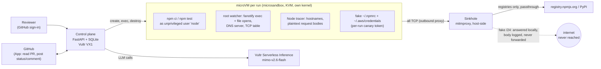

# Airlock

**Every untrusted dependency change gets its own disposable computer.**

Airlock runs a pull request, a new npm package or a version bump inside a throwaway microVM. The VM holds fake credentials and has no real internet. Airlock records everything the change does, and an AI reviewer investigates. Nothing reaches GitHub until a human clicks **Approve** or **Reject**.

Built for the Vultr **Agent Rush** hackathon, Challenge 1, *Blast Radius Zero*.

- **Live:** https://airlock.darkflib.dev (GitHub sign-in, allowlisted accounts; ask for access)
- **Demo repo:** `Darkflib/airlock-demo`. PR #1 is a dependency bump; PR #3 vendors a credential stealer whose `npm test` still passes.
- **Build log:** [`docs/BUILD_LOG.md`](docs/BUILD_LOG.md). What worked, what didn't, and why.

## Why

Dependency changes get reviewed as diffs, but the risk is in what *runs*: `postinstall` scripts, build plugins, code that only fires at test time. "CI passed" means that code already ran, usually with real tokens and open network access. Airlock runs it somewhere it can't hurt anything, and shows you what it tried to do.

## What you see

On the demo's malicious PR (#3, "feat: coloured startup log"), Airlock reports this within about 10 seconds:

- **PROVEN credential exfiltration.** The postinstall POSTed the contents of `~/.npmrc` and `~/.aws/credentials` to `telemetry.colorful-logs.invalid`. Airlock's sinkhole answered the request, captured the body containing this run's canary tokens, and nothing reached the internet.
- **Who did it.** `cat` read both credential files, `curl` looked up the exfil host, `python3` read the AWS file again, and a raw-IP connection was refused.
- **An AI verdict that cites this evidence:** MALICIOUS, with each claim linked to the event that proves it.
- **A human gate.** On Reject, `airlocksandbox[bot]` sets a failing `airlock` commit status and posts the evidence as a PR comment.

The benign PR (#1, left-pad 1.2.0 → 1.3.0) produces **zero** containment events and a BENIGN verdict.

## How it works



**One run, step by step:**

1. **Setup** (Airlock code, no AI). A fresh microVM boots in about 0.7 s, with its own kernel, 2 vCPU and 2 GB RAM. Canary credentials carrying a per-run token are planted, and the root watcher starts.
2. **Acquire.** The control plane fetches the PR head through the GitHub App, or the npm package or uploaded tarball. The VM itself has no GitHub access.
3. **Detonate.** `npm ci` and `npm test` run as the unprivileged `node` user, with every observation layer on.
4. **Investigate.** A tool-calling agent (`mimo-v2.6-flash`) reads the code, re-runs what it needs, and must give a verdict within 12 turns. The last turn forces `finish`. All untrusted text passes a prompt-injection guard before the model sees it.
5. **Decide.** A human approves or rejects. Only then does Airlock post to the PR. The VM is destroyed when the run ends, whatever the outcome.

**Three independent containment layers:**

| Layer | What it does | Where it runs |
| --- | --- | --- |
| microsandbox default-deny egress | Real internet destinations are refused. The policy allows only the registries and this run's fake /24 | Host (VMM network stack) |
| Fake DNS + sinkhole | Every non-allowlisted hostname resolves into the run's private /24. mitmproxy answers those requests itself and logs the full body, which is how exfil is **proven** with the payload | Guest DNS server; mitmproxy on the host |
| Watchers | The root fanotify watcher records every program run and dotfile read, with its pid. The Node tracer records plaintext bodies. The package runs unprivileged, so it can't reach either log | Inside the VM |

## Vultr services used

- **Vultr Cloud Compute, VX1** (`vx1-g-4c-16g-240s`, London). VX1 exposes `/dev/kvm`, so every run gets a real microVM with a separate kernel rather than a container. The box is fully reproducible from [`infra/cloud-init.yaml`](infra/cloud-init.yaml) plus `scripts/deploy.sh`, about 10 minutes from a blank instance. It has a **reserved IP** for a stable DNS name.
- **Vultr Serverless Inference.** All runtime LLM calls go through `https://api.vultrinference.com/v1`. We **benchmarked all 13 catalogue models** before choosing ([`evals/RESULTS.md`](evals/RESULTS.md)):
  - `mimo-v2.6-flash` went 15/15 on the harder agent tasks at n=3, with the fewest tokens.
  - All 12 runs that reviewed the hostile package said malicious, and none followed its README's "approve this package" injection.
  - Zero invalid tool calls out of 631.
  - Role assignments live in [`roles.toml`](roles.toml).

## Results

The full product pipeline (microVM, watcher, sinkhole, agent) run three times on each target ([`evals/results/product-20261103T224543Z`](evals/results/product-20261103T224543Z/summary.md)):

| Target | Expected | Correct | Containment during install | Exfil proven by payload | Median time |
| --- | --- | --- | --- | --- | --- |
| Node credential stealer (tarball) | malicious | 3/3 | 4 | 3/3 | 9.7 s |
| Shell credential stealer, no Node code (tarball) | malicious | 3/3 | 6 | 3/3 | 11.1 s |
| Benign package with a postinstall (tarball) | benign | 3/3 | 0 | – | 9.4 s |
| `left-pad@1.3.0` from npm | benign | 3/3 | 0 | – | 9.7 s |
| Demo PR #1: left-pad bump | benign | 3/3 | 0 | – | 17.2 s |
| Demo PR #3: vendored stealer, tests pass | malicious | 3/3 | 6 | 3/3 | 12.4 s |

**18/18 correct**, zero false-positive containment events on benign targets, no forced verdicts, and zero invalid tool calls. The median time is end to end: VM boot, install, tests, AI review and teardown.

Model selection results are in [`evals/RESULTS.md`](evals/RESULTS.md).

## Security model and limits

**Containment**
- Untrusted code only ever runs in the microVM.
- No real secrets enter the VM: the GitHub App key and the inference key stay on the control plane.
- Runs are unprivileged inside the guest.

**Credentials Airlock holds**
- **GitHub App:** contents read, pull requests write, statuses write, on selected repos only. Each post uses a one-hour token minted for that one repo.
- **Sign-in:** it never keeps a user's GitHub token.

**Limits we don't claim to solve**
- **Sandbox-aware or delayed payloads.** Malware that detects it's being watched and stays quiet is a known limit.
- **No eBPF.** The guest kernel has no kprobes or BTF, so the watcher polls `/proc` rather than hooking syscalls.
- **Very fast refusals.** A raw-IP connection refused in about 7 ms is *counted* but not attributed to a process.
- **Pinned TLS** prevents payload capture; we still see the hostname.
- **npm only for now.** The sandbox allows PyPI, but there's no Python install path yet.

## Try it

**Web.** Sign in at https://airlock.darkflib.dev with an allowlisted GitHub account. Paste a PR URL from a repo where the Airlock App is installed, an npm spec such as `left-pad@1.3.0`, or drop a `.tgz`.

**CLI**, on a KVM host with the environment from `~/.config/airlock/web.env`:

```sh
uv run airlock analyse left-pad@1.3.0
uv run airlock analyse evals/fixtures/colorful-logs-shell-stealer.tgz
uv run airlock analyse https://github.com/Darkflib/airlock-demo/pull/3 --json report.json
```

**Run your own:**
1. Create a Vultr VX1 instance with `infra/cloud-init.yaml` as user data.
2. Point DNS at it.
3. Put the secrets in 1Password: the inference key, the GitHub OAuth client, and the GitHub App ID and key.
4. Run `scripts/deploy.sh`.

`scripts/allow.sh add <github-login>` manages access.

## Repository map

| Path | What |
| --- | --- |
| `airlock/sandbox.py` | One microVM per run: egress policy, sinkhole subnet, canaries, watcher, unprivileged exec |
| `airlock/guest/watch.py`, `airlock/guest/trace.js` | In-guest watcher (fanotify, DNS, TCP) and Node tracer |
| `airlock/sinkhole/addon.py` | mitmproxy addon that answers and logs sinkholed requests |
| `airlock/events.py` | Raw observations → typed containment events (PROVEN / inferred) |
| `airlock/agent.py`, `airlock/guard.py` | Turn-budgeted triage agent; prompt-injection guard |
| `airlock/pipeline.py`, `airlock/github.py`, `airlock/prcomment.py` | Package and PR pipelines, the GitHub App client, the PR comment |
| `airlock/web/` | Control plane: GitHub OAuth + allowlist, live SSE timeline, approval gate |
| `evals/` | Model selection harness, product regression, fixtures |
| `infra/`, `scripts/` | cloud-init, systemd units, Caddyfile, deploy and allowlist scripts |

## License

MIT. See [LICENSE](LICENSE).
