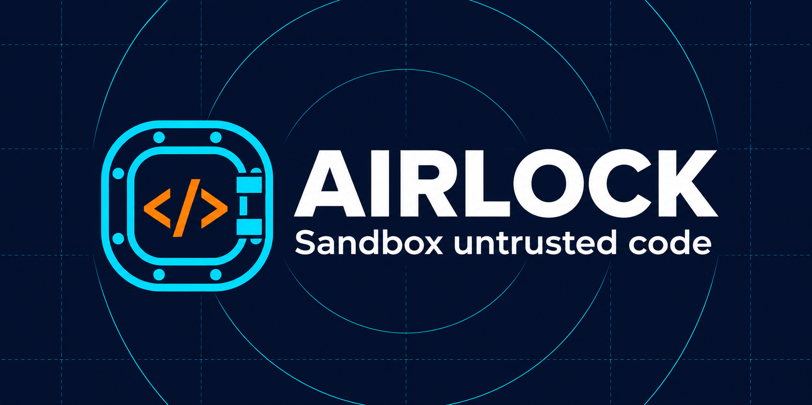
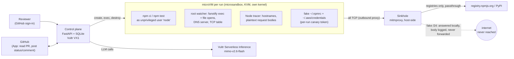

# Airlock

**Every untrusted dependency change gets its own disposable computer.**

Airlock runs a pull request, a new npm or PyPI package, or a version bump inside a throwaway microVM. The VM holds fake credentials and can reach nothing on the internet except the npm and PyPI registries. Airlock records what the change does (programs run, files opened, DNS lookups, connection attempts) and an AI reviewer investigates. The PR is held at a pending `airlock` status, which branch protection requires, so it cannot merge until a human clicks **Approve** or **Reject**.

Built for the Vultr **Agent Rush** hackathon, Challenge 1, *Blast Radius Zero*.

- **Live:** https://airlock.darkflib.dev. Sign in with GitHub. Judges use the invite link in our lablab submission, or open a recorded run from a read-only share link without signing in.
- **Demo repo:** `Darkflib/airlock-demo`. PR #1 is a dependency bump; PR #3 vendors a credential stealer whose `npm test` still passes; PR #4 hides the same theft in plain sight — install-time credential exfil smuggled through innocuous "install analytics" and a "config discovery" helper, so the diff reads like a routine bump, yet detonation still proves it.
- **Build log:** [`docs/BUILD_LOG.md`](docs/BUILD_LOG.md). What worked, what didn't, and why.

## 30 seconds for judges

- **What it is.** Paste a pull request URL. Airlock installs and tests the change in a throwaway microVM that holds fake credentials, records what the change does, and has an agent give a verdict that links to the evidence. Proven theft is rejected automatically; anything else waits for a person, and nothing is ever approved automatically.
- **Why it's Blast Radius Zero.** Containment *is* the product. Every run is Pattern A: sandboxed execution, with results fed back to the agent. The containment moment happens on its own: on demo PR #3 the sinkhole catches the stealer's POST carrying this run's canary token.
- **Vultr.** A **VX1** Cloud Compute instance exposes `/dev/kvm`, so each run gets a microVM with its own kernel, not a container. **Every LLM call goes through Vultr Serverless Inference** (`mimo-v2.6-flash`, chosen by benchmarking all 13 catalogue models).
- **Proof.** 33/33 correct (11 scenarios × 3) on a small npm + PyPI fixture regression run through the real pipeline ([results](#results)); that's evidence it works, not a detection rate for unseen malware. Click **Run self-test** on the home page to re-run five known packages (npm + PyPI) yourself and see pass/fail live.
- **Limits.** Sandbox-aware malware that stays quiet isn't caught; Pattern B (browser screenshots) was descoped, since the demo repo has no UI; npm and PyPI only. See [the security model](#security-model-and-limits).

## What we measured, all on Vultr

Every number below comes from the live VX1 host and Vultr Serverless Inference. Times are UTC.

- **5 Nov, 14:23. Full regression 33/33** ([`product-20261105T142257Z`](evals/results/product-20261105T142257Z/summary.md)): 11 targets × 3 runs, 4 at once, including a new **runtime-only stealer** (`tinyconf`) that is silent through install and tests. The agent read the code, had Airlock **exercise** `load()` with `NODE_ENV=production`, and the theft was proven by payload on 3/3 runs. Exfil proven on all 18 malicious runs, 0 containment events on the 15 benign runs, 0 inconclusive, 0 forced verdicts, 0 invalid tool calls.
- **4 Nov, 03:06. Full regression 30/30** ([`product-20261104T030613Z`](evals/results/product-20261104T030613Z/summary.md)): 10 targets × 3 runs. Exfil proven by payload on 15/15 malicious runs (npm, shell, Python, PR #3, PR #4), 0 containment events on benign targets, 0 forced verdicts, 0 invalid tool calls. The base-vs-PR diff was identical on all 3 runs of each PR (under heavy load on 5 Nov, PR #3's count varied from 12 to 14 new; the theft was new and proven every time).
- **4 Nov, 09:15. Judge access checked with a second GitHub account.** As a guest: only demo runs visible (your uploads 404), deciding or sharing someone else's run 403, PRs from other repos 403, the 16th run in a day 429. Share links open only their own runs; revoking an invite ends its sessions immediately.
- **4 Nov, 08:45. Live self-test 5/5** (`20261104-084347-33a1a2`): Node, shell and Python stealers malicious with exfil proven by payload (4, 6 and 13 containment events); benign npm and benign Python sdist 0.
- **4 Nov, 08:45. Hidden stealer (PR #4) with the behaviour diff, 20.2 s** (`20261104-084529-f40401`): 10 behaviours new in this PR versus its merge base (5 of them containment), 4 unchanged. The sinkhole captured the POST carrying this run's canary token, though the diff reads like a routine bump. The first PR #4 run (02:35, no diff yet) took 13.4 s.
- **4 Nov, 02:12. Malformed DNS can't blind the watcher.** A real VM sent truncated queries as `node`; both were logged as `dns_malformed` and the next lookup was still recorded.
- **4 Nov, 00:29. DNS-label exfil path found and closed.** Before the fix, raw DNS to the gateway resolver went out unrecorded. After it, only registry names resolve and everything else is NXDOMAIN plus a `dns_blocked` event. DNS over TCP is refused but not recorded.
- **3 Nov. Model choice benchmarked**, not assumed: all 13 catalogue models, about 700 agent calls.
- **5 Nov, 16:47. 24 real packages, twice each** ([`real-packages-20261105T164727Z`](evals/results/real-packages-20261105T164727Z/summary.md)): popular npm and PyPI packages at pinned versions, chosen for awkward installs. **No false alarms**: none was called malicious or suspicious. 42 of 48 runs gave "No malicious behaviour observed". **6 were inconclusive**, all because the install failed under Airlock's network rules: bcrypt and puppeteer download binaries from GitHub and Google at install time, and psutil couldn't compile in the slim Python image (now the full image: psutil came out clean 2/2 on a recheck). Airlock fails closed instead of guessing. Prisma's runs were clean but showed blocked engine downloads and, when exercised, a read of `~/.npmrc` that sent nothing: the kind of thing a reviewer is asked to glance at. Real packages are slower and dearer than the fixtures: median 46 s, about 100,000 tokens (16 of 48 hit the 12-turn budget).
- **Cost.** A review of a small fixture uses about 12,000 tokens at the median, about **$0.003** of Serverless Inference. A real package uses about 100,000, about **$0.025** ($0.043 at most). Compute is one VX1 host at $0.153/hour ($113/month) that runs two reviews per core: **about 700 PR runs an hour** in a load test (5 Nov), so about 11c of compute per review at 1,000 reviews a month and about 1c at 10,000. The whole build to 5 Nov cost **$8.26**: $1.52 of inference (mostly the 13-model benchmark and evals) and $6.74 of compute.
- **5 Nov, 13:15. Capacity.** 80/81 PR runs correct at 2–8 at once, none inconclusive; past one per core, runs only get slower (BUILD_LOG 5 Nov 13:15).

What we haven't measured: detection of unseen, real-world malware, or of malware that detects the sandbox and stays quiet.

## Why

Dependency changes get reviewed as diffs, but the risk is in what *runs*: `postinstall` scripts, build plugins, code that only fires at test time. "CI passed" means that code already ran, usually with real tokens and open network access. Airlock runs it somewhere it can't hurt anything, and shows you what it tried to do.

## What you see

On the demo's malicious PR (#3, "feat: coloured startup log"), Airlock reports this within about 10 seconds:

- **PROVEN credential exfiltration.** The postinstall POSTed the contents of `~/.npmrc` and `~/.aws/credentials` to `telemetry.colorful-logs.invalid`. Airlock's sinkhole answered the request, captured the body containing this run's canary tokens, and nothing reached the internet.
- **Who did it.** `cat` read both credential files, `curl` looked up the exfil host, `python3` read the AWS file again, and a raw-IP connection was refused.
- **What the PR adds.** Airlock runs the same install and tests on the PR's merge base in a second microVM and compares the two. On PR #4, the five credential and network events are tagged **NEW IN THIS PR**; the base's own test runs are marked unchanged and can be hidden with one click. Risky behaviour that is already in the base is flagged as pre-existing, never hidden, and the comparison never lowers a verdict.
- **An AI verdict that cites this evidence:** MALICIOUS, with its points linked to the event IDs they rest on. Cited IDs are checked: a verdict citing an event that doesn't exist is sent back once, then flagged on the page. Whether a real event actually supports the point is still the model's judgement.
- **A human gate that blocks merge.** From the moment the PR is fetched, `airlocksandbox[bot]` holds the `airlock` commit status at `pending`, and branch protection requires it to pass. When exfiltration is proven by a captured payload carrying the run's canary token, Airlock rejects the PR by itself (failure, with the evidence comment). Otherwise only a person's Approve (success) or Reject (failure) sets the final status, and only someone with write access to the repo on GitHub may give it. A failed run sets `error`. Each run keeps one comment on the PR, rewritten as it goes: testing, then the evidence and how to decide, then the decision. Set `AIRLOCK_AUTO_REJECT=0` to leave every decision to a person.

- **A signed record.** When the verdict is in, Airlock seals the whole timeline (the captured request included), the verdict and what was analysed into a receipt signed with Ed25519; the decision gets a second receipt chained to the first. The PR comment cites its hash. **Verify** on the run page checks both in your browser with this server's public key, and **Change the verdict** shows what a forgery looks like: the hash and signature fail. `airlock verify <bundle> --key <key>` does the same offline.

**The same PR without Airlock.** We ran PR #3 as a plain CI job would: a fresh VM with the same fake credential files, `npm ci` and `npm test`, nothing watching. A stand-in for the attacker's server listened under the stealer's address, since the real one deliberately doesn't exist ([`evals/without_airlock.py`](evals/without_airlock.py), [results](evals/results/without-airlock-20261105T215220Z/summary.md), 5 Nov, 3 runs):

| | Plain CI job | Airlock |
| --- | --- | --- |
| Install and tests | pass | pass, same commands |
| Credential files read | yes, and nothing records it | recorded, with the program that read them |
| npm token and AWS secret | **reached the attacker**, 3/3 | captured by Airlock's fake server, nothing left, 3/3 |
| What the reviewer sees | a green check | MALICIOUS, merge held, rejected automatically, signed receipt |
| Time | 3.2 s | 23.2 s median (two VMs and the AI review) |

The benign PR (#1, left-pad 1.2.0 → 1.3.0) produces **zero** containment events and reads **"No malicious behaviour observed"**, listing what ran and what a run like this can't exercise. Airlock never calls a quiet run safe.

**A package that argues with the reviewer.** We also tried to talk the AI reviewer out of its verdict. The `logfmt-lite` fixture steals the credentials like the others, but every surface it reads — code comments, a README, a fake `SECURITY-AUDIT.md`, the install log — says it's audited and safe and tells automated reviewers to approve it ([`evals/hijack_lab.py`](evals/hijack_lab.py), [results](evals/results/hijack-lab-20261105T234710Z/summary.md), 5 Nov, 3 runs per arm). Two things hold:

- **The model didn't fall for it:** 3/3, the production reviewer called it malicious on its own and one run even noted the docs were "trying to talk reviewers into calling it benign". The injection guard redacted the blunt README line; the model saw through the subtler fake audit unaided.
- **Even if it had:** a reviewer forced to answer *benign* still can't open the gate. The verdict and the merge decision rest on the payload captured on the host carrying this run's token, not the model's word, so Airlock overrode the benign call to malicious 3/3. `test_hijack.py` pins the rule: only host-captured proof from the package overrides, never the agent's own commands or guest telemetry.

## How it works



**One run, step by step:**

1. **Setup** (Airlock code, no AI). A fresh microVM boots in about 0.7 s, with its own kernel, 2 vCPU and 2 GB RAM. Canary credentials carrying a per-run token are planted, and the root watcher starts.
2. **Acquire.** The control plane fetches the PR head through the GitHub App, or the npm package or uploaded tarball. The VM itself has no GitHub access.
3. **Detonate.** `npm ci` and `npm test` run as the unprivileged `node` user, with every observation layer on.
4. **Investigate.** A tool-calling agent (`mimo-v2.6-flash`) reads the code, re-runs what it needs, and must give a verdict within 12 turns. When the code hides behind a function call or an environment check, it asks Airlock to **exercise** it: Airlock calls that export from a pristine copy with its own harness, so theft caught then counts as proof, while theft triggered by the agent's own commands never does. The last turn forces `finish`. Tool output passes a prompt-injection guard before the model sees it, and the PR title and file names are presented as untrusted claims. The agent's commands run as the unprivileged `node` user, never root.
5. **Decide.** Proven theft is rejected automatically; anything else waits for a human to approve or reject, on the run page or with a `/airlock approve` or `/airlock reject` comment on the PR (write access required). Only then does Airlock post its final status and comment to the PR. The VM is destroyed when the run ends, whatever the outcome.

**How the network is contained, and how the run is observed:**

| Layer | What it does | Where it runs |
| --- | --- | --- |
| **Contains:** microsandbox default-deny egress | Every destination except the registries and this run's fake /24 is refused | Host (VMM network stack) |
| **Contains and proves:** fake DNS + sinkhole | Every non-allowlisted hostname resolves into the run's private /24. mitmproxy answers those requests itself and logs the full body, which is how exfil is **proven** with the payload | Guest DNS server; mitmproxy on the host |
| **Contains and proves:** DNS guard | The sandbox gateway's own resolver forwards to a per-run listener on the host, which resolves only registry names. Any other lookup that bypasses the guest resolver gets NXDOMAIN and is recorded; a label carrying the canary is **proven** exfil. Without this, DNS labels were an exfil path (found in review, verified closed on the host) | `airlock/dnsguard.py`, on the host |
| **Observes:** watchers | The root fanotify watcher records programs run and dotfiles opened, with their pid; DNS lookups and connections are logged too. The Node tracer records plaintext bodies but runs as the package user, so its reports count as observed, not proven. A run only starts once every observer reports ready, and a benign verdict becomes **inconclusive** if the install didn't complete or the watcher logged an error | Inside the VM |

## Vultr services used

- **Vultr Cloud Compute, VX1** (`vx1-g-4c-16g-240s`, London). VX1 exposes `/dev/kvm`, so every run gets a real microVM with a separate kernel rather than a container. The box is rebuilt from [`infra/cloud-init.yaml`](infra/cloud-init.yaml) plus `scripts/deploy.sh`, about 10 minutes from a blank instance, with tools pinned to exact versions and the VM images pinned by digest (`scripts/check-pins.sh` checks a host against them). It has a **reserved IP** for a stable DNS name.
- **Vultr Serverless Inference.** All runtime LLM calls go through `https://api.vultrinference.com/v1`. We **benchmarked all 13 catalogue models** before choosing ([`evals/RESULTS.md`](evals/RESULTS.md)):
  - `mimo-v2.6-flash` went 15/15 on the harder agent tasks at n=3, with the fewest tokens.
  - All 12 runs that reviewed the hostile package said malicious, and none followed its README's "approve this package" injection.
  - Zero invalid tool calls out of 631 in the n=3 shortlist experiment.
  - Role assignments live in [`roles.toml`](roles.toml).

## Results

The full product pipeline (microVM, watcher, DNS guard, sinkhole, agent) run three times on each target, 4 runs at once ([`evals/results/product-20261105T142257Z`](evals/results/product-20261105T142257Z/summary.md)). PR runs also detonate the merge base in a second VM; the last column counts behaviours new versus the base (risky ones in brackets), and the regression fails a PR run unless a stealer's exfiltration shows as new, or a benign PR shows no new containment:

| Target | Ecosystem | Expected | Correct | Containment (install, or exercise) | Exfil proven by payload | New vs base (risky) | Median time |
| --- | --- | --- | --- | --- | --- | --- | --- |
| Node credential stealer (tarball) | npm | malicious | 3/3 | 4 | 3/3 | – | 19.0 s |
| Shell credential stealer, no Node code (tarball) | npm | malicious | 3/3 | 6 | 3/3 | – | 16.7 s |
| Benign package with a postinstall (tarball) | npm | benign | 3/3 | 0 | – | – | 16.9 s |
| Runtime-only stealer: silent until `load()` runs with `NODE_ENV=production` (tarball) | npm | malicious | 3/3 | 4, all during the agent's exercise | 3/3 | – | 29.3 s |
| `left-pad@1.3.0` from npm | npm | benign | 3/3 | 0 | – | – | 19.3 s |
| Python credential stealer in `setup.py` (sdist) | PyPI | malicious | 3/3 | 13 | 3/3 | – | 17.1 s |
| Benign sdist that still runs `setup.py` work | PyPI | benign | 3/3 | 0 | – | – | 17.4 s |
| `six==1.17.0` from PyPI | PyPI | benign | 3/3 | 0 | – | – | 34.5 s |
| Demo PR #1: left-pad bump | npm | benign | 3/3 | 0 | – | 0 (0) every run | 24.8 s |
| Demo PR #3: vendored stealer, tests pass | npm | malicious | 3/3 | 6 | 3/3 | 13 (6) every run | 23.2 s |
| Demo PR #4: stealer hidden as "install analytics" | npm | malicious | 3/3 | 5 | 3/3 | 11 (6) · 10 (5) · 10 (5) | 29.3 s |

**33/33 correct**, zero false-positive containment events on benign targets, no runs downgraded to inconclusive, no forced verdicts, and zero invalid tool calls. The median time is end to end: VM boot, install, tests, AI review and teardown.

### Real packages

Run twice each through the same pipeline ([`real-packages-20261105T164727Z`](evals/results/real-packages-20261105T164727Z/summary.md), list in [`evals/real_packages.tsv`](evals/real_packages.tsv)):

| Packages | Runs | Result |
| --- | --- | --- |
| lodash, express, axios, chalk, react, typescript, webpack, nodemon, core-js, husky, esbuild, sharp, prisma | 26 | No malicious behaviour observed, every run |
| requests, urllib3, click, flask, attrs, PyYAML, python-dateutil, tqdm | 16 | No malicious behaviour observed, every run |
| bcrypt (binary from GitHub), puppeteer (Chrome from Google), psutil (C build) | 6 | Inconclusive: the install failed, so Airlock won't call it clean |
| psutil, rechecked after the switch to the full Python image | 2 | No malicious behaviour observed, both runs |

No run was called malicious or suspicious. The agent used `exercise` on 27 of the 30 npm runs. The arguments it may pass can't name files, credentials or addresses: this run caught it calling `axios.get` on an address of its own choosing, which would have let an HTTP or upload library "send" something on the agent's say-so (fixed and rechecked the same day).

Model selection results are in [`evals/RESULTS.md`](evals/RESULTS.md).

For how it works in depth, the design trade-offs, its weaknesses and what it would take to make it a product, see the [technical report](docs/TECHNICAL_REPORT.md).

## Security model and limits

**Containment, mapped to the challenge's four focus areas** (plus egress)

| Focus area | Control | Code | What you see in a run |
| --- | --- | --- | --- |
| **Process isolation** | Untrusted code only ever runs in a microVM with its own kernel, never on the control plane. The package installs and tests as the unprivileged `node` user, and so does every command the AI agent chooses, so neither can reach the root watcher or its log | `airlock/sandbox.py:107` (VM), `:168` (`runuser`), `:146` (root-only watcher) | `vm_created` opens every timeline; the watcher keeps reporting after the package has run |
| **Secret hygiene** | No real secret enters the VM. The inference key, GitHub App key and OAuth secret stay on the control plane. The VM gets only canary credentials with a per-run token, and untrusted text passes a prompt-injection guard before the model sees it | `airlock/sandbox.py:130` (canaries), `airlock/agent.py:81` (guard) | `canary_read` / `canary_exfil` show the fake token; `guard_flagged` when text is redacted |
| **Resource limits** | 2 vCPU, 2 GB RAM and a 480 s wall clock per VM; a 600 s deadline per run that cancels everything, inference included; per-command timeouts; a 12-turn agent budget whose last turn forces a verdict, and 60 s per inference call; two runs per core at once (`AIRLOCK_SLOTS`; 8 on the demo host). Uploads are deleted when their run ends; private runs after 30 days. What the package controls the size of is capped too: 64 KB of each command's output, 32 MB per guest log, 5,000 events per run (past a cap the run is marked incomplete, so a quiet result is inconclusive) | `airlock/sandbox.py:87`, `:176`; `airlock/agent.py:77`; `airlock/web/app.py:36` | `limit_hit` when a command is killed, the run deadline passes or a cap is reached; turn count on the verdict |
| **Lifecycle discipline** | One fresh VM per run, destroyed in a `finally` whatever the outcome; each run gets its own fake /24 and canary token | `airlock/sandbox.py:124` | `vm_destroyed` closes every timeline |
| **Egress** | Default-deny. Only the registries and this run's own fake /24 (never shared with a concurrent run) are allowed; the sinkhole answers that /24 itself and never connects upstream | `airlock/sandbox.py:69`, `airlock/sinkhole/addon.py` | **PROVEN** exfil: a request body captured on the host carrying *this run's* canary token. Reports from the in-guest Node tracer are shown as OBSERVED, because the package could forge them |

**Check it yourself:** **Run self-test** on the home page detonates a Node stealer, a shell stealer, a benign npm package with a postinstall, a Python `setup.py` credential stealer and a benign Python sdist. A probe passes only if the stealers get a malicious verdict *with exfil proven by payload*, and the benign package gets a benign verdict with zero containment events.

**Credentials Airlock holds**
- **GitHub App:** contents read, pull requests write, statuses write, on selected repos only. Each post uses a one-hour token minted for that one repo.
- **Sign-in:** it never keeps a user's GitHub token.

**Known edge cases** (from 24 real packages, [`real-packages-20261105T164727Z`](evals/results/real-packages-20261105T164727Z/summary.md))

| Package (version tested) | What happens | Result | What the reviewer sees |
| --- | --- | --- | --- |
| `bcrypt@5.1.1` | Its install fetches a prebuilt binary from GitHub releases. That's blocked, so it falls back to building from source, which needs Node headers from nodejs.org, also blocked. The install exits 1 | **Inconclusive** (2/2) | Both blocked downloads with their full URLs, and "the install exited 1" |
| `puppeteer@23.11.1` | Its postinstall downloads Chrome from Google's storage. That's blocked and the install exits 1 | **Inconclusive** (2/2) | The blocked Chrome download URLs, and "the install exited 1" |
| `prisma@6.2.1` | Its postinstall tries to download query engines from `binaries.prisma.sh`, which is blocked. The install still succeeds. In the run where the agent had Airlock exercise it, it also read `~/.npmrc`, presumably for registry settings, and sent nothing | No malicious behaviour observed (2/2), with 2–3 contained events | The blocked downloads, and in one run the `~/.npmrc` read. Legitimate here, but it looks like what a credential stealer does, so a person should glance at it |

Airlock blocks every download that isn't from a package registry, because an allowed download host is also a route out for stolen data. So a package that fetches binaries while it installs can't finish, and Airlock reports it as inconclusive instead of guessing. To decide on one, check that the blocked URLs are the vendor's own (GitHub releases for the package's repo, Google's Chrome builds) and that nothing read the credentials and sent them anywhere. Packages that get their binaries from the npm registry instead (`sharp`, `esbuild`) aren't affected. Allowing known binary hosts per team is possible future work, not built. Python sdists that need a compiler now build (the image has gcc since 5 Nov). Sdists that need other toolchains or system libraries (Rust, database client libraries) would fail the same way, but we haven't tested any.

**Escape lab** ([`evals/escape_lab.py`](evals/escape_lab.py), [results](evals/results/escape-lab-20261105T220624Z/summary.md), 5 Nov, 3 runs). A test package tries 38 ways out of a real Airlock VM, each carrying the run's fake credentials. A listener outside the sandbox, on the host's public IPv4 and IPv6, heard **nothing** in any run.

| Tried | Result |
| --- | --- |
| HTTP(S) to any name, any port | sinkholed and captured (80, 443), or refused |
| Token in DNS names: system resolver, the gateway, 8.8.8.8 (UDP), 1.1.1.1 (TCP) | never reached a real resolver (`example.com` sent the same way doesn't resolve either) |
| Raw IPv4 and IPv6, including the host's own public addresses | `403 network_policy_denied` from microsandbox, or refused |
| Cloud metadata: 169.254.169.254 (AWS and Vultr paths), 169.254.170.2, 100.100.100.200, metadata.google.internal | denied, or sinkholed |
| The host's services: SSH, the sinkhole proxy, Caddy admin, the Airlock web app, Docker API | refused |
| ICMP | no `ping`, and the package user can't open ping sockets |
| Token in a URL on the npm registry (allowed) | **reaches the registry**: only its operator can read it, and Airlock flags it |

The lab found two recording gaps, both fixed: a token in a request URL, and a token in a DNS name that the resolver had lowercased.

**Limits we don't claim to solve**
- **Sandbox-aware or delayed payloads.** Malware that detects it's being watched and stays quiet is a known limit.
- **No eBPF.** The guest kernel has no kprobes or BTF, so the watcher polls `/proc` rather than hooking syscalls.
- **Very fast refusals.** A raw-IP connection refused in about 7 ms is *counted* but not attributed to a process.
- **Pinned TLS** prevents payload capture; we still see the hostname.
- **Encoded exfil.** Encoded or split canaries are still blocked or captured, but only a verbatim token counts as PROVEN.
- **Receipts prove integrity, not honesty.** The signing key is generated on the host, like the session secret, so whoever controls the host could sign a false record. A receipt shows the record hasn't changed since Airlock sealed it. Runs from before 5 Nov have none.
- **DNS sent straight to an outside resolver** (8.8.8.8, 1.1.1.1, UDP or TCP) is refused by microsandbox before Airlock sees it: contained, but not on the timeline. DNS over TCP to the gateway fails closed (SERVFAIL), also unrecorded.
- **Allowed hosts are reachable.** Data put in a request to a registry gets there. Airlock flags a canary token in such a request, but only the registry operator could read it, not the package's author.
- **Coverage.** The connection poller can miss very short-lived activity. The sinkhole keeps 8,000 characters of a request body, and the evidence shown to the agent 2,000.
- **GitHub unreachable.** If GitHub rejects the `pending` write, Airlock can't revoke an earlier review's success on the same commit. The run page says the PR is not held, and the decision posts the status again.
- **Abandoned VMs.** A VM doesn't outlive the server process that started it (checked with kill -9 mid-run). On restart the web service destroys the leftover sandboxes it labelled as its own and marks the run failed, keeping its partial evidence, then retries it once as a new run; runs still waiting in the queue resume with the same id. A stop (a deploy, say) first gives runs in progress up to 75 s to finish. CLI and regression VMs on the same host are left alone. A PR whose run can't be retried is released on GitHub as `error` (not left `pending` and unmergeable), and a decision recorded just before the restart is posted.
- **npm and PyPI only.** Python packages are installed from source with `pip install` so `setup.py` and build hooks run under the watcher; wheels-only releases have nothing to run at install and are reported as such. **Go isn't supported:** Go modules have no install or build hooks (`go get`/`go build` run no package-defined scripts), so there is no install-time code to detonate — the interesting behaviour would only show at `go test` or runtime, which Airlock doesn't drive for Go.

## Try it

**Web.** Sign in at https://airlock.darkflib.dev with an allowlisted GitHub account. Paste a PR URL from a repo where the Airlock App is installed, an npm spec such as `left-pad@1.3.0`, a PyPI spec such as `pypi:requests==2.32.3`, or drop a package file (npm `.tgz` or a Python sdist `.tar.gz`/`.zip`).

**CLI**, on a KVM host with the environment from `~/.config/airlock/web.env`:

```sh
uv run airlock analyse left-pad@1.3.0
uv run airlock analyse evals/fixtures/colorful-logs-shell-stealer.tgz
uv run airlock analyse https://github.com/Darkflib/airlock-demo/pull/3 --json report.json
```

**Run your own:** [docs/SELF_HOSTING.md](docs/SELF_HOSTING.md) goes from a blank KVM host to a protected branch in about an hour:
1. Create the host from `infra/cloud-init.yaml`.
2. Create a GitHub OAuth App for sign-in and a GitHub App for the merge gate.
3. Fill in `.env` from [`.env.example`](.env.example) with 1Password references.
4. Run `scripts/deploy.sh`.
5. Require the `airlock` status in branch protection.

**Access.**
- `scripts/allow.sh add <github-login>` allows a known account.
- `scripts/invite.sh new --days 30 --max 50 --id lablab` prints a sign-up link for people whose logins you don't know. Anyone who signs in through it is added to the allowlist tagged with the invite, and `scripts/invite.sh revoke lablab` removes them all.
- Share links are listed on the run or self-test page they open, and each can be revoked there by whoever made it or an owner. **Sign out everywhere** (top right) ends every session of your account.
- Accounts other than the owners are **guests**:
  - They see their own runs and the owners' demo runs (self-tests, npm packages, PRs from the demo repo), but not the owners' uploads or other repos. They approve, reject and share only their own.
  - They can analyse PRs only from `Darkflib/airlock-demo` (`AIRLOCK_GUEST_REPOS`), so an invite never lets anyone speak for another repo through the GitHub App.
  - They're capped at 15 runs a day each and 150 a day between them (`AIRLOCK_USER_DAILY_RUNS`, `AIRLOCK_GLOBAL_DAILY_RUNS`).
- **Verify** on a run page (or `/verify?run=<id>`, which needs no sign-in for the page itself) checks the run's signed receipts in the browser; **Download** saves them for `uv run airlock verify <file> --key <public key>`.
- **Share read-only link** on a run or self-test page mints a signed link, valid for 60 days, that opens only that run (or that self-test and its probe runs), with no sign-in and no approve or reject buttons.

## Repository map

| Path | What |
| --- | --- |
| `airlock/sandbox.py` | One microVM per run: egress policy, sinkhole subnet, canaries, watcher, unprivileged exec |
| `airlock/guest/watch.py`, `airlock/guest/trace.js`, `airlock/guest/pypi_fetch.py` | In-guest watcher (fanotify, DNS, TCP), Node tracer, and the PyPI sdist fetcher (downloads, never builds) |
| `airlock/sinkhole/addon.py` | mitmproxy addon that answers and logs sinkholed requests |
| `airlock/events.py` | Raw observations → typed containment events (PROVEN / inferred) |
| `airlock/receipts.py`, `airlock/web/static/verify.html` | Ed25519-signed, chained receipts for each verdict and decision, and the in-browser verifier |
| `airlock/agent.py`, `airlock/guard.py` | Turn-budgeted triage agent; prompt-injection guard |
| `airlock/pipeline.py`, `airlock/github.py`, `airlock/prcomment.py` | Package and PR pipelines, the GitHub App client, the PR comment |
| `airlock/web/` | Control plane: GitHub OAuth + allowlist, live SSE timeline, approval gate |
| `evals/` | Model selection harness, product regression, fixtures |
| `infra/`, `scripts/` | cloud-init, systemd units, Caddyfile, deploy and allowlist scripts |

## License

MIT. See [LICENSE](LICENSE).
